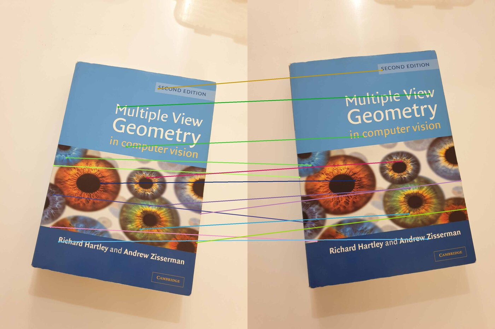
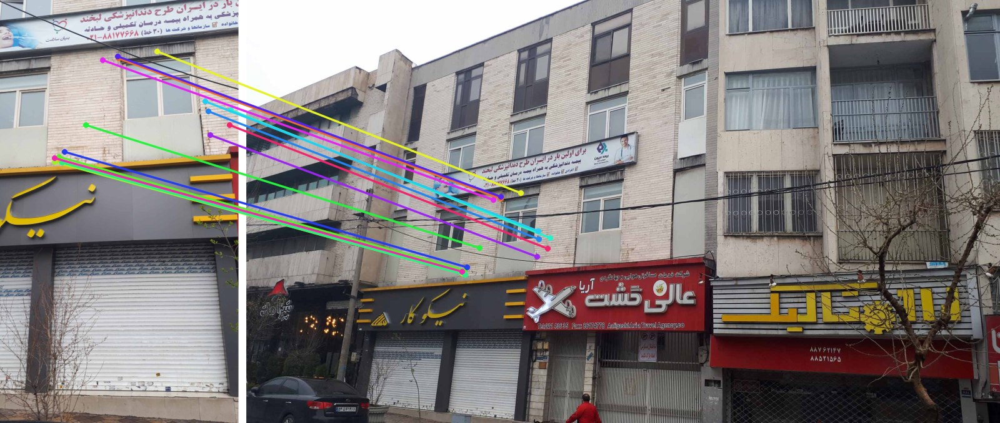
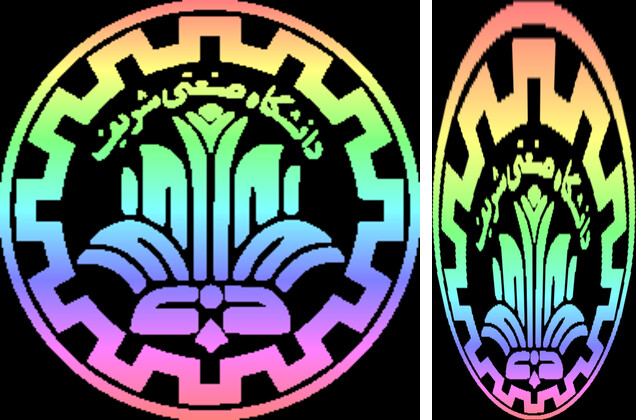

# Feature Matching and Homography

## Harris corners



`harris_matching.py` implements the Harris detector from scratch: Sobel gradients, a structure tensor smoothed with an 11×11 Gaussian ($\sigma = 2$), the response $R = \det M - k\,(\operatorname{tr} M)^2$ with $k = 0.05$, then a threshold and one point per connected component. Each corner is described by its 11×11 RGB patch, and a match is kept only if it passes the ratio test ($d_2/d_1 > 1.8$) in both directions.

## Homography with RANSAC



*The 17 inliers the from-scratch RANSAC keeps out of 254 SIFT matches.*

`homography_sift_ransac.py` matches SIFT features and estimates the homography with OpenCV's RANSAC. `homography_ransac_scratch.py` does the same with a from-scratch RANSAC: a 4-point DLT solved with SVD, an adaptive iteration count $N = \log(1-p) / \log(1-w^4)$ with $p = 0.99$, and a final refit on all inliers. Only 17 of the 254 matches agree on one homography within 2 px, so $w \approx 0.07$ and the adaptive count reaches about 229k iterations.

## Plane-induced homography



`perspective_logo.py` finds what to paint on the ground so that a camera 40 m away and 25 m up sees the logo undistorted. The ground plane seen from that camera and from a virtual top-down camera is related by $H = K'(R - t n^T / d) K^{-1}$; warping the logo (left) by $H^{-1}$ gives the pattern to paint (right).

## Run

```bash
pip install -r requirements.txt
python harris_matching.py
python perspective_logo.py
python homography_sift_ransac.py
python homography_ransac_scratch.py
```
