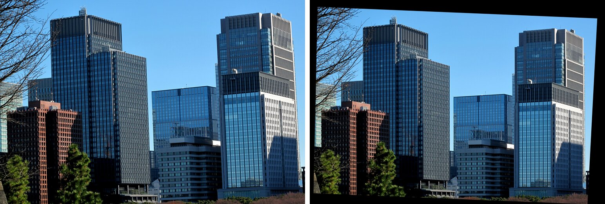

# Vanishing Points and Rectification



From a single photo: find three orthogonal vanishing points, recover the focal length and principal point from them, and rotate the view so vertical edges become vertical.

- `vanishing_points.py`: Canny edges and Hough lines, split into three families by angle. Each vanishing point is the least-squares intersection of its family (via SVD), and the horizon is $V_x \times V_y$.
- `camera_intrinsics_from_vps.py`: with zero skew and square pixels, the constraints $V_i^T \omega V_j = 0$ give $f$ and $(p_x, p_y)$ in closed form, followed by the camera's roll and tilt.
- `rectify.py`: removes the rotation with $H = K R K^{-1}$.

| $f$ | $(p_x, p_y)$ | Roll | Tilt |
|---|---|---|---|
| 14067 px | (2487, 1410) | −2.32° | −5.94° |

## Run

```bash
pip install -r requirements.txt
python vanishing_points.py
python camera_intrinsics_from_vps.py
python rectify.py
```
