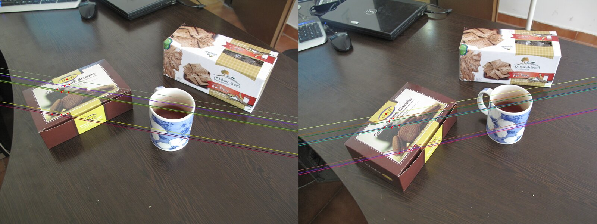
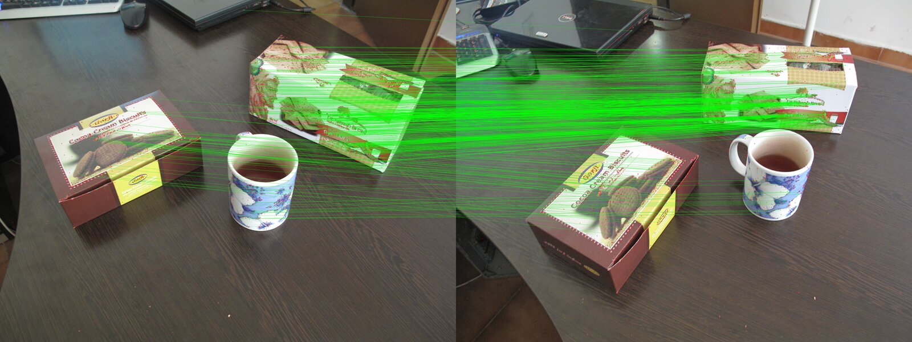

# Epipolar Geometry



`epipolar.py` matches SIFT features between two photos, estimates the fundamental matrix with RANSAC (`cv2.findFundamentalMat`), and draws the epipolar lines $l' = F x$ and $l = F^T x'$ for ten inlier matches. The epipoles are the null spaces of $F$ and $F^T$:

$$e = (-47873,\ -6943), \qquad e' = (17046,\ -1102)$$

Both lie far outside the frame, so the epipolar lines are nearly parallel: the camera moved mostly sideways between the two shots.



*Matches kept as RANSAC inliers.*

## Run

```bash
pip install -r requirements.txt
python epipolar.py
```
