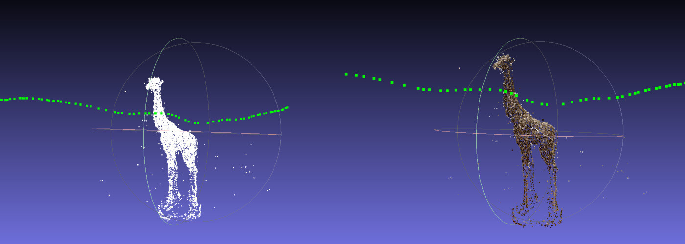

# Structure from Motion

3D reconstruction of a giraffe statue from 30+ photos taken around it, with [OpenMVG](https://github.com/openMVG/openMVG) (SIFT features, pairwise matching, incremental SfM with bundle adjustment). Left: geometry; right: colored from the photos. The green points are the recovered camera positions.

The point clouds are in `giraffe_res/` (`cloud.ply`, `colorized.ply`) and can be opened in [MeshLab](https://www.meshlab.net). The input photos are in [this Drive folder](https://drive.google.com/drive/folders/1izPa4sI1PReAIs8U77VesHXpXhiQfq72).
