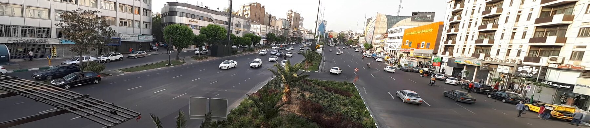
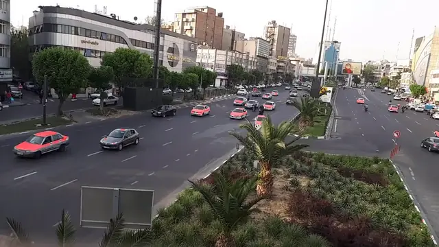
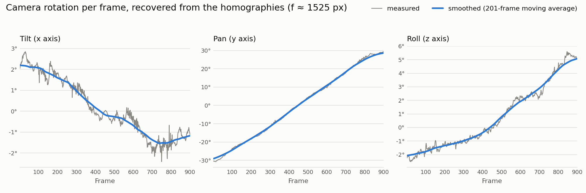

# Video Panorama, Background Subtraction, and Stabilization




*Top: five keyframes stitched along minimum-difference seams. Bottom: per-pixel median of all 900 frames; the moving traffic disappears, parked cars stay.*

`video_pipeline.py` processes the first 900 frames (30 s) of a street video shot by a rotating camera. Every frame is mapped to the middle frame (450) by a homography; frames too far away to match directly are chained through keyframes 90, 270, 630, and 810 (e.g. $H_{90 \to 450} = H_{270 \to 450} H_{90 \to 270}$). Each stage is one function:

| Stage | Function | Method |
|---|---|---|
| Two-frame stitch | `stitch_two_keyframes` | SIFT + RANSAC homography |
| Five-keyframe panorama | `stitch_keyframe_panorama` | Minimum-difference seam through each overlap, found with dynamic programming |
| Reference-plane video | `warp_video_to_reference` | Every frame warped into frame 450's plane |
| Background panorama | `background_panorama` | Per-pixel median over all frames, computed in 20 px strips to fit in memory |
| Background video | `background_video` | Background panorama warped back into each frame |
| Foreground video | `foreground_video` | Frame minus background, thresholded, cleaned with opening and closing |
| Wider video | `wider_background_video` | Background video with a wider field of view |
| Shake removal | `shake_removal` | $f$ estimated from the homographies ($f \approx 1525$ px), each $H_i = K R_i K^{-1}$ decomposed into Euler angles, angles smoothed over time, frames re-warped |



*Foreground video: pixels that differ from the background are tinted red.*

<picture>
  <source media="(prefers-color-scheme: dark)" srcset="../assets/06_rotation_dark.png">
  
</picture>

*Shake removal: each frame is re-warped from its measured rotation to the smoothed one.*

Full-resolution outputs are in [this Drive folder](https://drive.google.com/drive/folders/1izPa4sI1PReAIs8U77VesHXpXhiQfq72).

## Run

Put the video at `inputs/videos/video.mp4` and extract its frames before the first run (the script reads frame 450 at startup). The stages are called at the bottom of `video_pipeline.py`; uncomment the ones to run, starting with `compute_homographies()`.

```bash
pip install -r requirements.txt
mkdir -p inputs/videos/frames outputs/{two_keyframes,keyframes_panorama,reference_plane_video,background_panorama,background_video,foreground_video,wider_background_video,stabilized_video} outputs/temps/{ref_plane_frames,background_panorama_frames,background_video_frames,foreground_frames,wider_bg_frames,stabilized_frames}
ffmpeg -t 00:00:30 -i inputs/videos/video.mp4 -vf fps=30 inputs/videos/frames/frame%d.png
python video_pipeline.py
```
