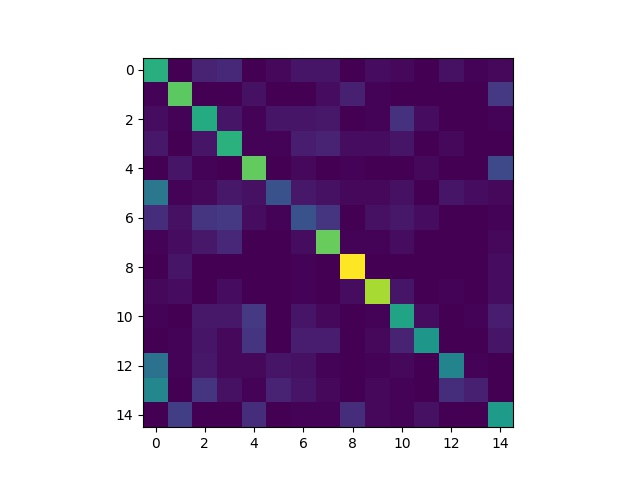

# Scene Recognition with Bag of Words

Classifying the 15-scene dataset (2,985 training and 1,500 test images) with three classical pipelines:

| Pipeline | Script | Test accuracy |
|---|---|---|
| 22×22 tiny images + kNN ($k = 1$, L1) | `tiny_image_knn.py` | 22.0% |
| SIFT bag of words (110 words) + kNN ($k = 20$) | `bow_knn.py` | 47.2% |
| SIFT bag of words (110 words) + SVM | `bow_svm.py` | 54.3% |

The bag-of-words model clusters all training SIFT descriptors into a 110-word vocabulary with k-means and describes each image by its histogram of words. Image size, $k$, and vocabulary size were chosen with a grid search (`FIND_BEST_HYPER_PARAMETERS = True`). A CNN on the same data reaches about 89%, see [09](../09-cnn-scene-recognition/).



*Confusion matrix of the SVM (rows: true class, columns: predicted class).*

## Run

Extract the dataset to `inputs/Data/Train` and `inputs/Data/Test`.

```bash
pip install -r requirements.txt
mkdir -p outputs/temps
python tiny_image_knn.py
python bow_knn.py
python bow_svm.py
```
