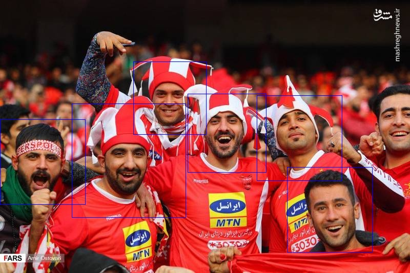
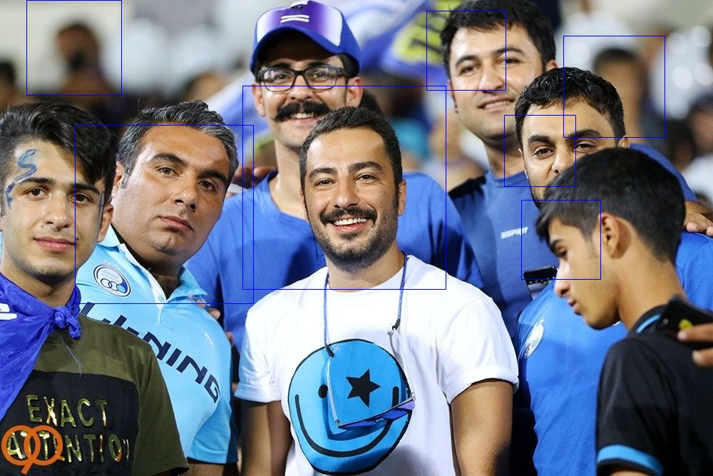

# Face Detection with HOG and SVM


`face_detector.py` trains a face / non-face SVM on HOG features and runs it as a multi-scale sliding-window detector.

- **Data:** face crops from [LFW](http://vis-www.cs.umass.edu/lfw/) as positives; images from [Natural Images](https://www.kaggle.com/datasets/prasunroy/natural-images) (person class removed, plus horizontal flips) as negatives, split into train, validation, and test sets.
- **Parameter search** on the validation set over window size, HOG orientations, cell size, block size, block norm, and SVM kernel. Best: 100×100 window, 16 orientations, 8×8 cells, 2×2 blocks, L2 norm, polynomial kernel.
- **Test set:** 99.75% accuracy on held-out face and non-face crops.
- **Detection:** the window slides with a 7 px stride over the image at scales 1.0, 0.95, 0.90, …; windows with a high face probability are merged with non-maximum suppression.

Harder cases, crowd photos taken at close range:

<p>
  
  
</p>

## Run

Put LFW in `inputs/datasets/lfw/` and Natural Images in `inputs/datasets/archive/natural_images/`. With `FIND_BEST_PARAMETERS = True`, the full parameter search runs before detection.

```bash
pip install -r requirements.txt
python face_detector.py
```
