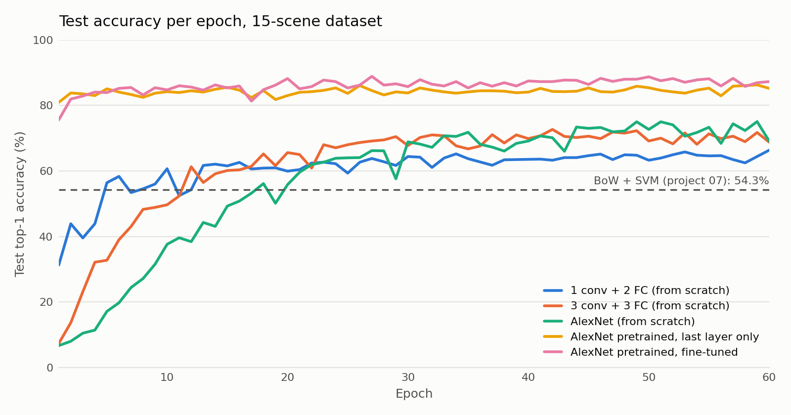

# Scene Recognition with CNNs

The 15-scene problem from [07](../07-bow-scene-recognition/), now with five AlexNet-based models in PyTorch, from a single conv layer trained from scratch to an ImageNet-pretrained AlexNet:

| # | Model | Top-1 | Top-5 |
|---|---|---|---|
| 1 | 1 conv + 2 FC, from scratch | 68–69% | 94–95% |
| 2 | 3 conv + 3 FC, from scratch | 75–76% | 98–99% |
| 3 | AlexNet, from scratch | 78–79% | 98–99% |
| 4 | AlexNet pretrained on ImageNet, only the last layer trained | 87–88% | 99.7% |
| 5 | AlexNet pretrained on ImageNet, fine-tuned | 89–90% | 99.9% |

<picture>
  <source media="(prefers-color-scheme: dark)" srcset="../assets/09_accuracy_dark.png">
  
</picture>

*Test accuracy per epoch in one of the logged runs (`logs/res3.log`).*

With about 2,985 training images, AlexNet trained from scratch stays below 80%, while the pretrained features with only a new last layer already pass 85%. All models use SGD (lr 0.001, momentum 0.9) with flip and histogram-equalization augmentation. Logs and per-model plots of three full runs are in `logs/` and `outputs/run_*/`.

## Run

Extract the dataset to `Data/Train` and `Data/Test` next to the script.

```bash
pip install -r requirements.txt -f https://download.pytorch.org/whl/torch_stable.html
mkdir -p models
python train_alexnet.py
```
