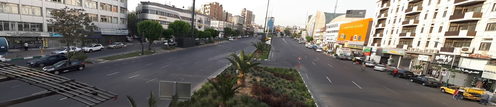
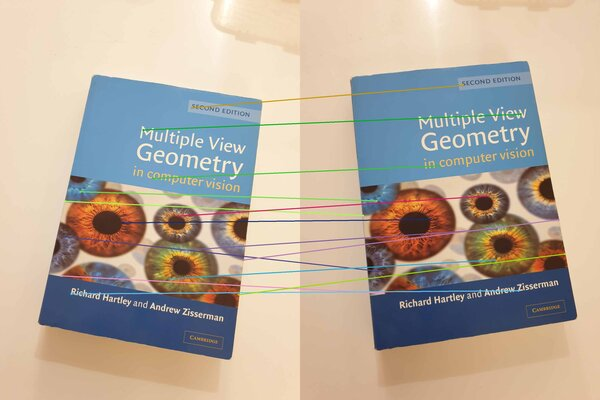
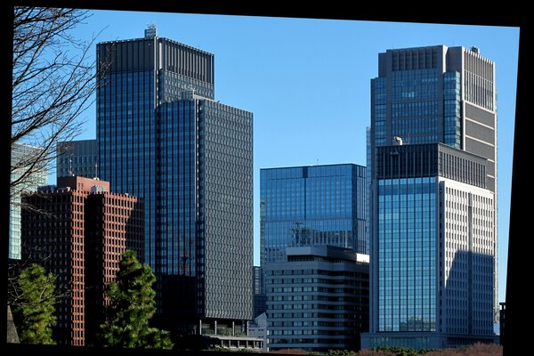
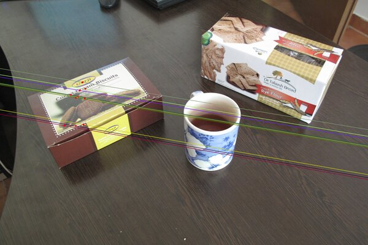
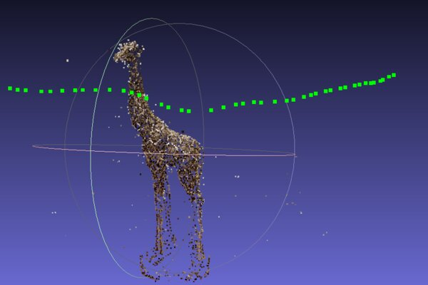
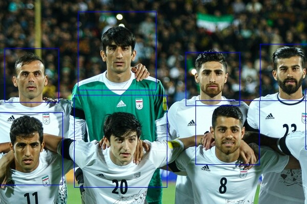
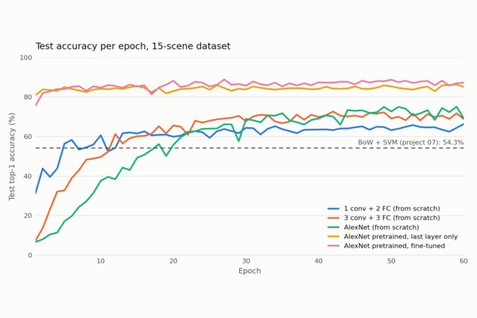

# Computer Vision Projects

*900 video frames aligned by homographies and merged with a per-pixel median, which removes the moving traffic ([06](06-video-panorama-and-background/)).*

Nine projects covering classical and learning-based computer vision: feature matching, projective geometry, multi-view reconstruction, video processing, and recognition. Several core algorithms (Harris corners, RANSAC homography, calibration from vanishing points, seam stitching, median background modeling) are implemented from scratch with NumPy and OpenCV.

<table>
  <tr>
    <td align="center"> Harris corners and matching</td>
    <td align="center"> Rectification from vanishing points</td>
    <td align="center"> Epipolar geometry</td>
  </tr>
  <tr>
    <td align="center"> Structure from Motion</td>
    <td align="center"> HOG + SVM face detection</td>
    <td align="center"> CNN scene recognition</td>
  </tr>
</table>

| | Project | Topics |
|---|---|---|
| 01 | [Feature matching and homography](01-feature-matching-and-homography/) | Harris detector, ratio-test matching, RANSAC + DLT from scratch, plane-induced homography |
| 02 | [Vanishing points and rectification](02-vanishing-points-and-rectification/) | Hough lines, vanishing points, focal length and principal point from one image |
| 03 | [Camera calibration](03-camera-calibration/) | Zhang's method, stability across image subsets |
| 04 | [Epipolar geometry](04-epipolar-geometry/) | Fundamental matrix with RANSAC, epipoles, epipolar lines |
| 05 | [Structure from Motion](05-sfm-3d-reconstruction/) | 3D point cloud of a statue from 30+ photos with OpenMVG |
| 06 | [Video panorama and background](06-video-panorama-and-background/) | Keyframe panorama with DP seams, median background, foreground video, shake removal |
| 07 | [Bag-of-words scene recognition](07-bow-scene-recognition/) | Tiny images, SIFT bag of words, kNN and SVM |
| 08 | [HOG face detection](08-hog-face-detection/) | HOG + SVM, parameter search, multi-scale sliding window, NMS |
| 09 | [CNN scene recognition](09-cnn-scene-recognition/) | Five AlexNet variants, from scratch vs. ImageNet transfer learning |

Projects 07 and 09 solve the same 15-scene problem: 54.3% with bag of words + SVM, about 89% with a fine-tuned AlexNet.

Each folder has its own README and `requirements.txt` (Python 3.9). Stack: NumPy, OpenCV, scikit-image, scikit-learn, PyTorch, OpenMVG.
